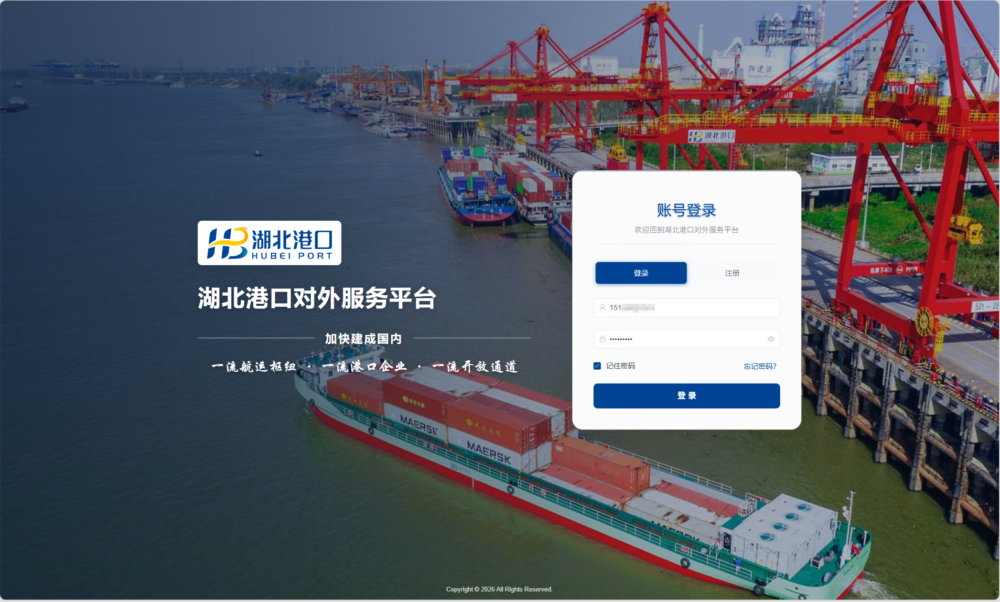

<figure class="project-hero">
  
</figure>

面向船公司与船代、货代、车队与司机、客户企业、监管单位及各港区，项目建设集团集装箱业务统一服务入口、统一 EDI 数据通道和集装箱专题数据底座，推动业务从“多系统、多渠道、多次填报”转向“一个平台、一套标准、一次填报、多方共享”。

  
我的角色<strong>大模型组主要负责人</strong>

  
核心方向<strong>OCR 智能体与 AI 助手</strong>

  
交付形态<strong>私有化模型服务与智能工作流</strong>

## 项目背景与需求

港口行业正由传统装卸向智慧物流枢纽转型，口岸单证电子化、物流信息开放共享和跨主体数据协同已成为核心能力。湖北港口集团集装箱业务覆盖多个港区，连接船公司、船代、货代、车队、客户、监管单位以及 TOS、箱管、场站、理货等内部系统，业务参与方多、信息链路长、系统基础不一。

现有业务主要面临四类问题：

- **对外服务入口分散：** 船公司、船代、货代和车队等主体需要在多个系统、多个渠道办理业务和查询信息。
- **业务协同链条不顺：** 放箱令、受理计划、船期计划和运抵报告等仍存在邮件传递、表格流转、人工录入与重复维护。
- **港区系统与标准异构：** 各港区 TOS、箱管、理货等系统建设基础不一，数据标准、报文格式和统计口径尚未完全统一。
- **集团主题数据底座不足：** 缺少稳定、标准、可追溯的集装箱业务主题数据资产，难以支撑实时监控、经营分析与后续系统建设。

因此，平台不替代现有码头生产系统，也不改变港区现场作业主流程，而是通过统一门户、统一标准、统一通道和统一数据资源层，建设业务办理与查询、EDI 报文接入转换分发、开放接口、数据治理及 AI 助手等能力，打通客户、平台、港区生产系统与集团数据中心之间的协同链路。

## 我的角色与任务

作为大模型组主要负责人，我负责大模型技术方案、模型与智能体建设、业务工作流集成及上线交付，推动 AI 能力与放箱令、装卸船计划、预受理计划等港口业务场景深度衔接。

- **领域模型建设：** 完成训练数据清洗、标签复核、领域微调、多维评测和难例迭代，形成面向物流业务的分类与信息抽取能力。
- **OCR 智能体建设：** 构建面向提单、箱单、放箱令和舱单等复杂港口单据的 OCR 智能体，支持图片、PDF、Excel 和报文文本解析，完成关键字段提取、JSON Schema 结构化输出与业务规则校验。
- **AI 助手融合：** 将 OCR、文本与表格提取等智能体接入 AI 助手。用户既可通过文字问答描述业务，也可上传图片或文件；助手负责识别意图、提取数据、自动填充表单、提示缺失或冲突信息，并调用业务工具推进办理。
- **推理与工作流集成：** 基于 SGLang 部署模型服务，通过 Dify、MCP 和领域 API 编排工作流，支撑上下文推理、工具调用、结构化输出与业务系统联动。
- **评测与上线：** 建立固定测试集、难例集、回归评测和性能压测流程，对模型版本和业务规则进行联合验证。
- **生产保障：** 完成服务监控、日志审计、异常降级、故障恢复和自启动策略，保证私有化环境中的持续可用性。

## OCR 智能体与 AI 助手

  
01<strong>文字问答或文件上传</strong>

  
02<strong>意图识别与单证解析</strong>

  
03<strong>关键字段结构化提取</strong>

  
04<strong>表单填充与规则校验</strong>

  
05<strong>用户确认与业务调用</strong>

AI 助手以自然语言对话为统一交互入口。用户可以直接提出“办理提重箱计划”等需求，也可以上传图片、Excel、PDF 或报文文本；OCR 智能体及数据提取智能体识别箱号、提单号、船名航次、箱型箱量等关键字段，并自动映射到业务表单。对缺失或不一致的数据，助手会明确提示并引导补充；用户核对确认后，再由工作流调用相应业务接口，形成可追溯的人机协同闭环。

## 技术路径

  
01<strong>多渠道业务资料接入</strong>

  
02<strong>OCR 与多模态理解</strong>

  
03<strong>字段标准化与规则校验</strong>

  
04<strong>Dify 与 MCP 工作流编排</strong>

  
05<strong>业务回执与全链路审计</strong>

模型负责理解非标内容和生成候选结构，规则引擎负责必填项、码表、状态与权限校验。对低置信度或关键业务字段保留人工复核入口，避免将模型输出直接作为生产指令。

## 核心成果

<ul class="project-output-list">
  <li>完成 Qwen 系列语言模型、视觉语言模型、Embedding 与 Reranker 的私有化部署及统一服务接入。</li>
  <li>放箱令分类在多套测试集上的最高 F1 达到 <strong>98.78%</strong>，经难例迭代后生产准确率提升至 <strong>99.2%</strong>。</li>
  <li>形成覆盖物流单证、复杂表格和集装箱视觉信息的多模态解析能力，并输出业务可消费的结构化 JSON。</li>
  <li>建立模型、数据、规则、接口和监控协同的工程闭环，使智能能力能够在权限与审计边界内稳定运行。</li>
</ul>

## 技术栈

  QwenTransformersPEFT / LoRASGLangPaddleOCRYOLODifyMCPFastAPICUDA

<a class="project-back-link" href="/research/">← 返回研究项目</a>
